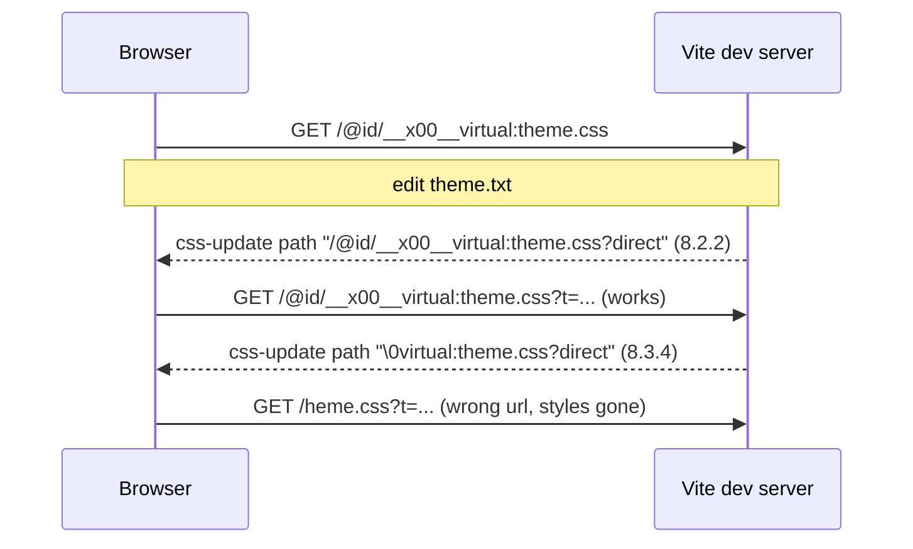

# Vite 8.3: css HMR breaks for a virtual stylesheet loaded with `<link>`

A plugin serves a virtual stylesheet, `\0virtual:theme.css`. index.html loads it with a `<link>`, and there is no JS import.

On Vite 8.2.2, editing the source file swaps the stylesheet in place. On Vite 8.3.4, the new `<link>` points to `/heme.css?t=...`, so the page loses its styles.

We found this while working on [yak](https://github.com/DigitecGalaxus/next-yak), a CSS-in-JS library with a Vite plugin. With Qwik, every yak stylesheet is a virtual module loaded through a `<link>`, so every style edit broke the page.

## When does it happen

Both have to be true:

1. The browser loads the stylesheet through a `<link>` tag, for example one the server renders during SSR in dev.
2. The stylesheet is a virtual module whose id starts with `\0`.

CSS imported from JS is fine, because it goes through `js-update`. A `<link>` to a real `.css` file is fine too.

## Try it

```sh
npm install
npm run dev        # vite 8.3.4
```

1. Open http://localhost:5173. The background is pink.
2. Change `theme.txt` from `hotpink` to `lightblue` and save.
3. The background turns white. The `<link>` now points to `/heme.css?t=...`.

Run the same steps on 8.2.2 to compare:

```sh
npm run dev:8.2    # vite 8.2.2, the background turns blue
```

## What goes over the websocket



8.2.2:

```json
{"type":"css-update","path":"/@id/__x00__virtual:theme.css?direct","acceptedPath":"/@id/__x00__virtual:theme.css?direct"}
```

8.3.4:

```json
{"type":"css-update","path":"\u0000virtual:theme.css?direct","acceptedPath":"\u0000virtual:theme.css?direct"}
```

The change is probably from https://github.com/vitejs/vite/pull/23172 (remove HmrUrl concept). It looks like `js-update` still handles the raw id, but `css-update` does not.

## Files

- `vite.config.js`: the plugin, about 20 lines. It has no HMR code of its own.
- `index.html`: the `<link>`.
- `theme.txt`: the color the stylesheet is built from.
